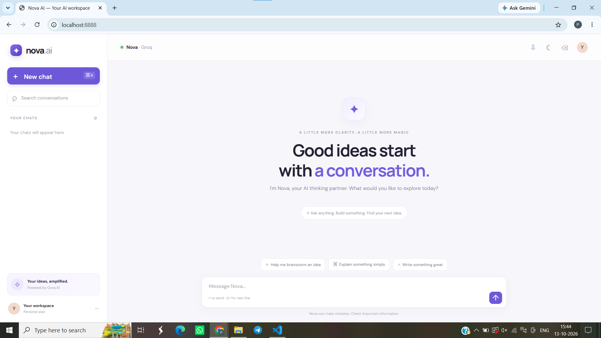
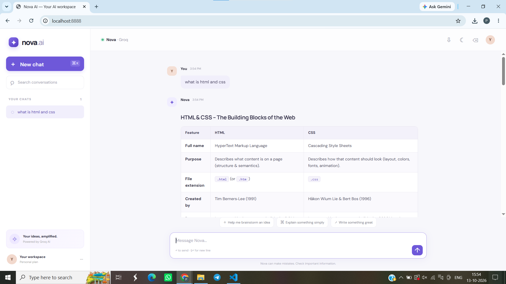

# Nova AI

Nova AI is a responsive AI chatbot built with HTML, CSS, and vanilla JavaScript. It sends questions to Groq through a Netlify Function, keeping the API key on the server. Conversations are saved in the browser, and replies can include formatted text, code, and tables.

## Project screenshots

### Chat home

The landing screen offers a clean starting point, suggested prompts, searchable conversations, and a message composer.

### Formatted AI response

Assistant replies are formatted for easier reading, including structured comparison tables.

## Features

- Create, search, rename, delete, clear, switch, and export conversations
- Save conversations in this browser's `localStorage` (they do not sync between devices)
- Include recent messages as context for follow-up questions
- Format assistant replies as Markdown, including headings, lists, code blocks, links, and tables
- Copy replies or code blocks, regenerate the latest reply, and stop waiting for a response
- Light and dark themes, responsive layout, loading indicator, and friendly error messages